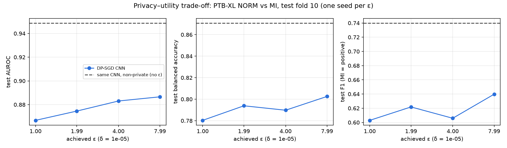
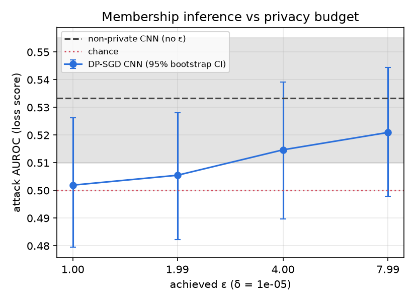
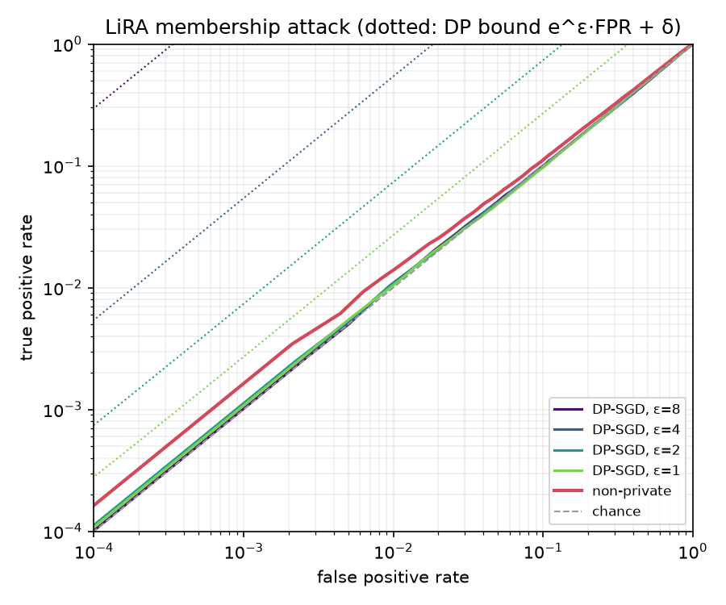
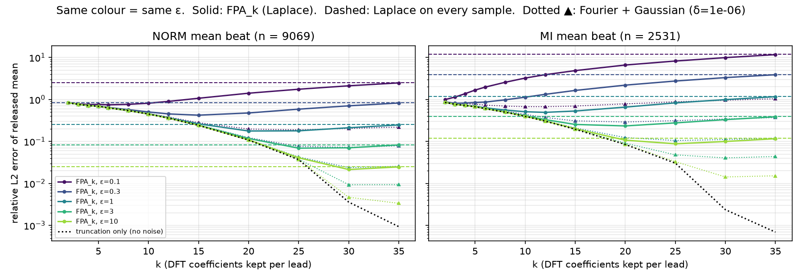
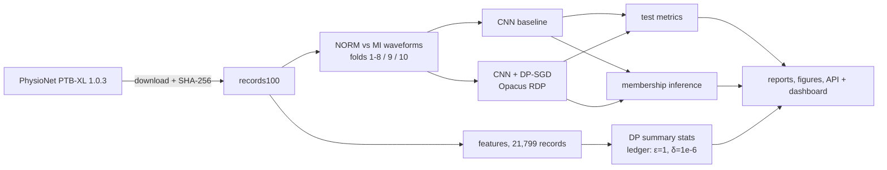

# Differentially Private ECG Classification

Laplace and Gaussian mechanisms written from scratch in NumPy and checked on every neighbour of a small dataset
universe. They are used for budgeted private summary statistics over all 21,799 PTB-XL ECGs. A 1D CNN that
separates normal ECGs from myocardial infarction is trained with and without DP-SGD (Opacus), the accuracy cost is
measured at ε = 1, 2, 4 and 8, and a membership-inference attack tests what the privacy budget buys in practice.

> Research code, not a medical device. Model scores are experimental outputs, not diagnoses.

**Status (3 Nov 2026).**
- Done: everything below has been run on this machine on the full PTB-XL data: three seeds per configuration
  (15 training runs), a threshold membership attack, a LiRA shadow-model attack (80 shadow models), and a
  Fourier-domain perturbation study (Rastogi & Nath 2010).
- Not done: the Docker image has not been built (Docker daemon unavailable here) and the dashboard is not deployed.

---

## Results (PTB-XL NORM vs MI, test fold 10, n = 1,168, 21.9% MI)

Mean ± sample sd over 3 seeds. Each seed is a full training run with a different initialisation, batch sampling and
noise draw; the data split is the same for all of them.

| model | achieved ε (δ = 10⁻⁵) | noise multiplier | test AUROC | balanced acc. | F1 (MI) | membership-attack AUROC |
|---|---|---|---|---|---|---|
| CNN, non-private | – (no guarantee) | – | **0.942 ± 0.006** | 0.863 ± 0.008 | 0.736 ± 0.003 | 0.535 ± 0.002 |
| CNN, DP-SGD, target ε = 8 | 7.99 | 0.75 | 0.887 ± 0.003 | 0.796 ± 0.006 | 0.626 ± 0.013 | 0.517 ± 0.006 |
| CNN, DP-SGD, target ε = 4 | 4.00 | 1.01 | 0.884 ± 0.003 | 0.794 ± 0.003 | 0.620 ± 0.014 | 0.511 ± 0.006 |
| CNN, DP-SGD, target ε = 2 | 1.99 | 1.49 | 0.874 ± 0.005 | 0.785 ± 0.008 | 0.613 ± 0.009 | 0.504 ± 0.005 |
| CNN, DP-SGD, target ε = 1 | 1.00 | 2.50 | 0.864 ± 0.009 | 0.778 ± 0.013 | 0.597 ± 0.021 | 0.499 ± 0.004 |

Generated from `artifacts/metrics/runs/*.json` and `artifacts/metrics/membership_inference.json`. Every individual
run, with its bootstrap CI for the attack, is in
[`artifacts/reports/results_summary.md`](artifacts/reports/results_summary.md).




**What the numbers say, and what they don't.**
- **Utility.** DP-SGD costs 5.5–8 AUROC points. Most of the cost appears as soon as clipping and noise are on: going
  from ε = 8 to ε = 1 loses only 2.3 more points. Mean AUROC falls at every step from ε = 8 to ε = 1. The ε = 8 and
  ε = 4 results overlap within one sd; the steps to ε = 2 and ε = 1 (about 0.01 each) are larger than the spread.
- **Calibration.** The DP models are poorly calibrated. Their validation-chosen thresholds are 0.003–0.010, against
  0.19–0.40 for the baseline. Ranking (AUROC) holds up better than the 0.5-threshold accuracy would suggest.
- **Membership inference.** The loss-threshold attack does better than chance against all three non-private models
  (each run's 95% bootstrap CI excludes 0.5; mean AUROC 0.535). Against every one of the 12 DP models its CI
  includes 0.5. The mean attack AUROC falls steadily with ε: 0.517 at ε = 8 down to 0.499 at ε = 1.
- **Limits of the attack evidence.** The effect is small in absolute terms, so this is consistent with the theory,
  not a demonstration of it. The threshold attack is weak; the LiRA attack below is the stronger test. The formal
  guarantee is the accountant's ε, not the attack AUROC.
- **Seeds.** Three seeds measure training randomness only, not the uncertainty from the particular test fold.

## Stronger attack: LiRA with shadow models

Online LiRA (Carlini et al. 2022): for each configuration, 16 shadow models are trained with the same recipe, each
on a random half of the 9,286 training records, so every record is "in" about 8 models and "out" of about 8. A
record's score in one model compares its logit-scaled confidence with the in and out distributions estimated from
the other 15 models (leave-one-model-out, global variances). That gives 148,573 scored (record, model) pairs per
configuration, half of them members. 80 shadow models in total; the DP ones reach their target ε (achieved 7.996,
3.992, 1.995, 0.992).

| model | LiRA AUROC | TPR at FPR 0.1% | DP bound at FPR 0.1% | TPR at FPR 1% | DP bound at FPR 1% |
|---|---|---|---|---|---|
| non-private | 0.517 | 0.19% | – | 1.40% | – |
| DP-SGD, ε = 8 | 0.496 | 0.09% | 100% | 1.08% | 100% |
| DP-SGD, ε = 4 | 0.497 | 0.12% | 5.5% | 1.06% | 54% |
| DP-SGD, ε = 2 | 0.499 | 0.10% | 0.74% | 1.08% | 7.4% |
| DP-SGD, ε = 1 | 0.499 | 0.12% | 0.27% | 1.05% | 2.7% |

The DP bound is the most any attack can achieve under (ε, δ)-DP: TPR ≤ e^ε·FPR + δ.



- **Non-private model.** At low false-positive rates LiRA identifies members about 1.4–1.9 times more often than
  chance (0.19% vs 0.1%, 1.4% vs 1%). That is real but small leakage: this model is small (59k parameters),
  trained for 12 epochs and selected on validation, so it overfits little.
- **DP models.** Their ROC curves sit on the chance diagonal at every FPR shown, far below the DP bound, at every ε.
- **AUROC is not the headline.** LiRA's overall AUROC for the baseline (0.517) is lower than the threshold attack's
  (0.535), because the two use different protocols: LiRA's shadow models train on half the data and are scored over
  the whole pool, while the threshold attack targets full-data models against the test fold. The low-FPR numbers
  are the ones LiRA is designed for.
- **No CIs here.** Each record is scored in 16 models, so the 148,573 scores are not independent; I have not
  computed a confidence interval, and differences of ±0.004 from 0.5 should not be read as meaningful.

## Fourier perturbation of ECG beats (Rastogi & Nath 2010)

The query is the mean 12-lead heartbeat of each class (12 leads × 70 samples around the R peak, 100 Hz), from
median-beat templates of the 11,601 NORM/MI records (one MI record had no detectable beat).
Each record's template is clipped to L2 norm ≤ 8 (6% are
clipped), so one record moves the sum by at most 8. The mean is a noisy sum over a noisy count (10% of ε on the
count). NORM and MI are disjoint, so the two releases compose in parallel.

FPA_k keeps the first k DFT coefficients per lead, adds noise to them and inverts. I compared it with Laplace noise
on all 840 samples (LPA) and with the analytic Gaussian on all samples, plus a Gaussian version of FPA_k. Relative
L2 error of the released mean, averaged over 200 draws (best k per ε):

| class, ε | LPA (Laplace, samples) | FPA_k (Laplace) | Gaussian, samples (δ = 10⁻⁶) | FPA_k + Gaussian |
|---|---|---|---|---|
| MI (n = 2,531), ε = 1 | 1.18 | 0.49 (k = 12) | 0.12 | 0.11 |
| MI, ε = 0.1 | 11.8 | 0.99 (k = 2) | 1.04 | 0.67 |
| NORM (n = 9,069), ε = 1 | 0.25 | 0.18 (k = 20) | 0.026 | 0.024 |



- **FPA_k beats LPA at every ε and both classes**, as the paper claims: cutting to k coefficients shrinks both the
  number of noisy values and the L1 sensitivity factor (√(12(2k−1)) instead of √840).
- **But Gaussian noise on the raw samples beats FPA_k (Laplace)** by 4–7× at ε ≥ 1, at the cost of a δ. Adding the
  Fourier step to the Gaussian helps mainly at small ε and for the smaller MI class.
- **k was chosen by looking at the error**, which uses the data. A real release would fix k in advance. Full
  numbers: `artifacts/metrics/fourier_perturbation.csv`; derivation: KNOWLEDGE.md §11b.

## Private summary statistics (all 21,799 records, total ε = 1.0, δ = 10⁻⁶)

[`artifacts/reports/dp_summary_statistics.json`](artifacts/reports/dp_summary_statistics.json) contains six releases:
- a record count
- mean heart rate and mean QRS width (Laplace)
- mean Sokolow–Lyon voltage and mean age (analytic Gaussian)
- a 15-bin heart-rate histogram

Each release lists its query, clipping bounds, sensitivity, mechanism, noise scale and its share of the budget. A
ledger shows the shares add up to exactly ε = 1.0, δ = 10⁻⁶ (basic composition), and the ledger refuses any release
that would overspend. Exact values are not published.

An internal diagnostic repeats the mean-heart-rate release 2,000 times per ε and compares the observed error with the
noise formula. They agree at every ε from 0.01 to 2 (`artifacts/figures/dp_mean_error.png`). Getting there exposed a
mistake in my first error formula; the story is in KNOWLEDGE.md §6.

## Mechanism verification

[`artifacts/reports/mechanism_verification.md`](artifacts/reports/mechanism_verification.md): all multisets of size
≤ 4 over a 4-value domain, giving 140 add/remove neighbour pairs, are checked for count, clipped sum, centred sum and
histogram queries:
- **sensitivity:** never exceeded, and attained
- **Laplace:** closed-form worst-case log-ratio ≤ ε
- **Gaussian:** exact δ(ε) ≤ δ
- **Two-sided geometric mechanism:** an exact check on every integer output

These checks guard the implementation. The guarantee for arbitrary data comes from the theorems and sensitivity proofs
in [KNOWLEDGE.md](KNOWLEDGE.md), not from testing finitely many datasets.

---

## What is implemented

| part | where | notes |
|---|---|---|
| Laplace, Gaussian (analytic + classical), geometric mechanisms | `src/dp_ecg/privacy/` | NumPy only; calibration and sampling separated |
| Sensitivities, neighbour enumeration, exhaustive checks | `privacy/sensitivity.py`, `neighbours.py`, `verification.py` | add/remove-one adjacency |
| Budget ledger, DP count / sum / mean / histogram | `privacy/accounting.py`, `statistics.py` | basic composition, refuses overspending |
| PTB-XL download, metadata, NORM vs MI selection, splits | `src/dp_ecg/data/` | SHA-256 verified; patient-leakage check raises |
| Fixed preprocessing (0.5–40 Hz band-pass, ÷1 mV, clip ±5 mV) | `data/preprocessing.py` | nothing fitted to data: no privacy cost |
| 1D CNN with GroupNorm | `models/cnn.py` | Opacus-validated before every DP run |
| Shared baseline / DP-SGD loop | `training/loop.py` | Poisson sampling, RDP accountant, requested and achieved ε stored separately |
| Membership inference (loss, max-prob, entropy) | `attacks/membership.py` | thresholds from val fold; evaluated on test fold |
| LiRA shadow-model attack | `attacks/lira.py` | 16 shadow models per configuration, cached and resumable |
| Fourier perturbation (FPA_k) | `privacy/fourier.py`, `evaluation/fourier_study.py` | orthonormal DFT, conjugate-symmetric real vector |
| Reports, figures | `evaluation/` | built only from saved artifacts |
| FastAPI + Gradio dashboard | `app/` | reads saved results; `/predict` only if a checkpoint exists |



## Data

PTB-XL v1.0.3 (Wagner et al., *Scientific Data* 2020, doi:10.1038/s41597-020-0495-6; PhysioNet
doi:10.13026/kfzx-aw45), CC BY 4.0. It has 21,799 ten-second 12-lead ECGs from 18,869 patients. Only the 100 Hz
records are used (about 600 MB). The data is not redistributed here.

Task selection: a record is kept only if its diagnostic superclass set is exactly {NORM} or exactly {MI}. That gives
9,069 NORM and 2,532 MI. Excluded:
- 9,786 records with other superclasses
- 411 with no diagnostic superclass
- 1 with both NORM and MI

Official folds: 1–8 train (9,286 records, 8,522 patients), 9 validation (1,147), 10 test (1,168). No patient
appears in two splits; the code checks this. See [docs/dataset_card.md](docs/dataset_card.md).

## Reproduce

Requires Python ≥ 3.10, about 1.5 GB of disk, and a CPU. On an 8-core laptop the download takes about 25 minutes and everything else about 25 minutes.

```bash
make install
```
```bash
make all
```

`make all` runs, in order:
- `download` and `prepare`
- `verify-mechanisms`
- `summary-stats`
- `train-baseline` and `train-dp`
- `attack` and `lira` (LiRA trains 80 small models: several hours on a laptop CPU)
- `fourier`
- `report`

Each step is also available as `PYTHONPATH=src .venv/bin/python -m dp_ecg.cli <step>`. Completed training runs are
skipped on re-runs; delete a run's JSON to redo it.

```bash
make test
```

`make test` runs 81 tests with pytest, all on synthetic data, so no download is needed. `make smoke` runs the whole
pipeline on a tiny synthetic dataset; its numbers are never PTB-XL results.

Settings live in [`configs/`](configs). The experiment protocol is in
[docs/experiment_protocol.md](docs/experiment_protocol.md).

## DP-SGD configuration

| setting | value |
|---|---|
| clipping norm C | 1.0 |
| expected batch size | 256 |
| sampling | Poisson, q = 1/37 ≈ 0.027 |
| epochs / steps | 12 / 444 |
| optimiser | Adam, lr 0.002 |
| accountant | Opacus RDP |
| δ | 10⁻⁵ (about 1/(10n)) |

The noise multiplier is found by Opacus for each target ε. Achieved ε is recomputed after training and stored
next to the requested value, and runs over target by more than 1% are flagged (none were). The best epoch is
chosen by validation AUROC. The reported ε is for the full run, which is conservative.

The baseline uses the same CNN, Adam with lr 0.001, batch 128 and 12 epochs. It has no privacy guarantee.

## Threat model and limitations (short version; full: [docs/limitations.md](docs/limitations.md))

* **Record-level, not patient-level.** Some patients have several ECGs. See KNOWLEDGE.md §1 and §12.
* **What the accountant covers.** It covers DP-SGD only. The summary statistics are a separate release with their
  own budget. Hyperparameters were fixed by hand before the sweep, not tuned per ε, but earlier exploratory runs in
  this repo's history touched the same training data, and that exploration is not accounted for.
* **Secure RNG is off.** `torchcsprng` has no build for the installed PyTorch. Floating-point Laplace sampling has
  known side channels (Mironov 2012). This is a research implementation.
* **Three seeds, one train/test split.** LiRA scores have no confidence intervals, and its shadow models train on
  half the data, so they are weaker than the full-data models in the main table.

## API and dashboard

```bash
make serve
```

This starts FastAPI and a Gradio dashboard on http://127.0.0.1:7860:
- `/` dashboard
- `GET /health`, `/metadata`, `/experiments`, `/privacy-results`
- `POST /predict`, which needs a local checkpoint

The dashboard shows only saved results and "pending" when they are missing. It accepts no uploads.

## Docker and deployment

`Dockerfile` (non-root, health check, port 7860) and `docker-compose.yml` are provided. **The image has not been built
or tested yet**, because no Docker daemon was available on the development machine. Build commands and the
Hugging Face Spaces procedure are in [docs/deployment.md](docs/deployment.md). Nothing is deployed.

## Repository layout

```
configs/        YAML settings (data, baseline, dp_sgd, privacy_mechanisms, attack incl. LiRA)
src/dp_ecg/     privacy/  data/  models/  training/  attacks/  evaluation/  app/  cli.py  experiments.py
tests/          unit/  privacy/  integration/  smoke/
artifacts/      metrics/  figures/  reports/   (checkpoints/ and logs/ are git-ignored)
docs/           architecture, methodology, threat model, dataset card, protocol, limitations, deployment
KNOWLEDGE.md    derivations and design decisions
```

## References

Dwork & Roth 2014; Balle & Wang, ICML 2018; Abadi et al., CCS 2016; Mironov, CSF 2017; Yeom et al., CSF 2018;
Carlini et al., S&P 2022; Yousefpour et al. 2021 (Opacus); Wagner et al., Sci. Data 2020; Rastogi & Nath,
SIGMOD 2010.

Licence: MIT (code). PTB-XL: CC BY 4.0.
