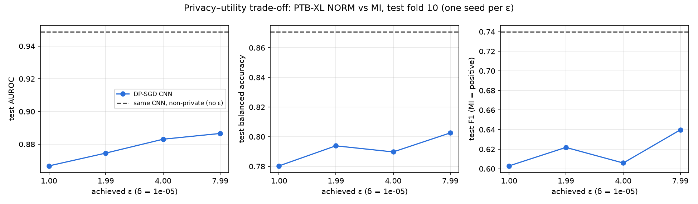
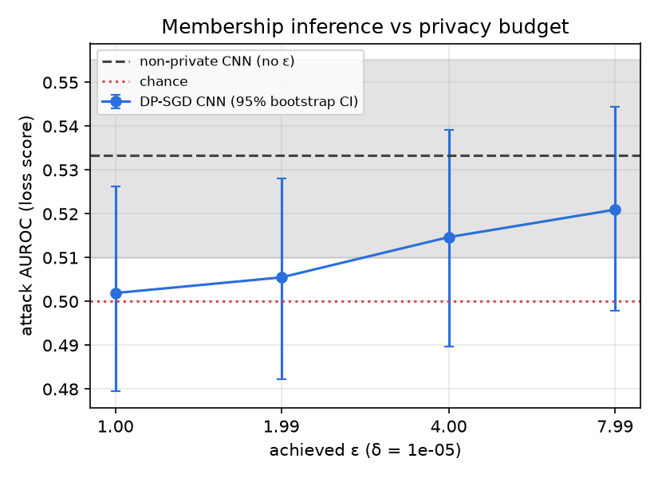
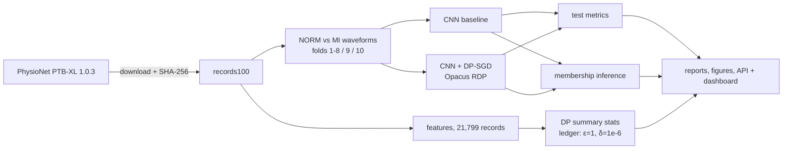

# Differentially Private ECG Classification

Laplace and Gaussian mechanisms written from scratch in NumPy and checked on every neighbour of a small dataset
universe. They are used for budgeted private summary statistics over all 21,799 PTB-XL ECGs. A 1D CNN that
separates normal ECGs from myocardial infarction is trained with and without DP-SGD (Opacus), the accuracy cost is
measured at ε = 1, 2, 4 and 8, and a membership-inference attack tests what the privacy budget buys in practice.

> Research code, not a medical device. Model scores are experimental outputs, not diagnoses.

**Status (22 Oct 2026).**
- Done: everything below has been run on this machine on the full PTB-XL data.
- Not done: the Docker image has not been built (Docker daemon unavailable here) and the dashboard is not deployed.
  There is one seed per ε, so run-to-run variance is not yet measured.
- Planned: a stronger membership attack (LiRA with shadow models) and Fourier-domain perturbation of ECG time
  series (Rastogi & Nath 2010).

---

## Results (PTB-XL NORM vs MI, test fold 10, n = 1,168, 21.9% MI)

| model | requested ε | achieved ε (δ = 10⁻⁵) | noise multiplier | test AUROC | balanced acc. | F1 (MI) | membership-attack AUROC [95% CI] |
|---|---|---|---|---|---|---|---|
| CNN, non-private | – | – (no guarantee) | – | **0.949** | 0.871 | 0.740 | 0.533 [0.510, 0.555] |
| CNN, DP-SGD | 8 | 7.99 | 0.75 | 0.887 | 0.803 | 0.640 | 0.521 [0.498, 0.544] |
| CNN, DP-SGD | 4 | 4.00 | 1.01 | 0.883 | 0.790 | 0.606 | 0.515 [0.490, 0.539] |
| CNN, DP-SGD | 2 | 1.99 | 1.49 | 0.875 | 0.794 | 0.622 | 0.506 [0.482, 0.528] |
| CNN, DP-SGD | 1 | 1.00 | 2.50 | 0.867 | 0.780 | 0.603 | 0.502 [0.479, 0.526] |

Generated from `artifacts/metrics/runs/*.json` and `artifacts/metrics/membership_inference.json`; full table in
[`artifacts/reports/results_summary.md`](artifacts/reports/results_summary.md).




**What the numbers say, and what they don't.**
- **Utility.** DP-SGD costs 6–8 AUROC points. Most of the cost appears as soon as clipping and noise are on: going
  from ε = 8 to ε = 1 loses only 2 more points.
- **Calibration.** The DP models are poorly calibrated. Their validation-chosen thresholds are below 0.01, against
  0.19 for the baseline. Ranking (AUROC) holds up better than the 0.5-threshold accuracy would suggest.
- **Membership inference.** The loss-threshold attack does slightly better than chance against the non-private model
  (CI excludes 0.5). Against the DP models it is indistinguishable from chance (every CI includes 0.5), and its AUROC
  falls as ε falls.
- **Limits of the attack evidence.** The differences between models are small and the CIs overlap, so this is
  consistent with the theory, not a demonstration of it. The attack is weak; a stronger one could find more leakage
  in the baseline. The formal guarantee is the accountant's ε, not the attack AUROC.
- **One seed.** Each configuration was run once. The ordering at ε = 2 vs 4 in balanced accuracy and F1 is within
  noise.

## Private summary statistics (all 21,799 records, total ε = 1.0, δ = 10⁻⁶)

[`artifacts/reports/dp_summary_statistics.json`](artifacts/reports/dp_summary_statistics.json) contains six releases:
- a record count
- mean heart rate and mean QRS width (Laplace)
- mean Sokolow–Lyon voltage and mean age (analytic Gaussian)
- a 15-bin heart-rate histogram

Each release lists its query, clipping bounds, sensitivity, mechanism, noise scale and its share of the budget. A
ledger shows the shares add up to exactly ε = 1.0, δ = 10⁻⁶ (basic composition), and the ledger refuses any release
that would overspend. Exact values are not published.

An internal diagnostic repeats the mean-heart-rate release 2,000 times per ε and compares the observed error with the
noise formula. They agree at every ε from 0.01 to 2 (`artifacts/figures/dp_mean_error.png`). Getting there exposed a
mistake in my first error formula; the story is in KNOWLEDGE.md §6.

## Mechanism verification

[`artifacts/reports/mechanism_verification.md`](artifacts/reports/mechanism_verification.md): all multisets of size
≤ 4 over a 4-value domain, giving 140 add/remove neighbour pairs, are checked for count, clipped sum, centred sum and
histogram queries:
- **sensitivity:** never exceeded, and attained
- **Laplace:** closed-form worst-case log-ratio ≤ ε
- **Gaussian:** exact δ(ε) ≤ δ
- **Two-sided geometric mechanism:** an exact check on every integer output

These checks guard the implementation. The guarantee for arbitrary data comes from the theorems and sensitivity proofs
in [KNOWLEDGE.md](KNOWLEDGE.md), not from testing finitely many datasets.

---

## What is implemented

| part | where | notes |
|---|---|---|
| Laplace, Gaussian (analytic + classical), geometric mechanisms | `src/dp_ecg/privacy/` | NumPy only; calibration and sampling separated |
| Sensitivities, neighbour enumeration, exhaustive checks | `privacy/sensitivity.py`, `neighbours.py`, `verification.py` | add/remove-one adjacency |
| Budget ledger, DP count / sum / mean / histogram | `privacy/accounting.py`, `statistics.py` | basic composition, refuses overspending |
| PTB-XL download, metadata, NORM vs MI selection, splits | `src/dp_ecg/data/` | SHA-256 verified; patient-leakage check raises |
| Fixed preprocessing (0.5–40 Hz band-pass, ÷1 mV, clip ±5 mV) | `data/preprocessing.py` | nothing fitted to data: no privacy cost |
| 1D CNN with GroupNorm | `models/cnn.py` | Opacus-validated before every DP run |
| Shared baseline / DP-SGD loop | `training/loop.py` | Poisson sampling, RDP accountant, requested and achieved ε stored separately |
| Membership inference (loss, max-prob, entropy) | `attacks/membership.py` | thresholds from val fold; evaluated on test fold |
| Reports, figures | `evaluation/` | built only from saved artifacts |
| FastAPI + Gradio dashboard | `app/` | reads saved results; `/predict` only if a checkpoint exists |



## Data

PTB-XL v1.0.3 (Wagner et al., *Scientific Data* 2020, doi:10.1038/s41597-020-0495-6; PhysioNet
doi:10.13026/kfzx-aw45), CC BY 4.0. It has 21,799 ten-second 12-lead ECGs from 18,869 patients. Only the 100 Hz
records are used (about 600 MB). The data is not redistributed here.

Task selection: a record is kept only if its diagnostic superclass set is exactly {NORM} or exactly {MI}. That gives
9,069 NORM and 2,532 MI. Excluded:
- 9,786 records with other superclasses
- 411 with no diagnostic superclass
- 1 with both NORM and MI

Official folds: 1–8 train (9,286 records, 8,522 patients), 9 validation (1,147), 10 test (1,168). No patient
appears in two splits; the code checks this. See [docs/dataset_card.md](docs/dataset_card.md).

## Reproduce

Requires Python ≥ 3.10, about 1.5 GB of disk, and a CPU. On an 8-core laptop the download takes about 25 minutes and everything else about 25 minutes.

```bash
make install
```
```bash
make all
```

`make all` runs, in order:
- `download` and `prepare`
- `verify-mechanisms`
- `summary-stats`
- `train-baseline` and `train-dp`
- `attack`
- `report`

Each step is also available as `PYTHONPATH=src .venv/bin/python -m dp_ecg.cli <step>`. Completed training runs are
skipped on re-runs; delete a run's JSON to redo it.

```bash
make test
```

`make test` runs 70 tests with pytest, all on synthetic data, so no download is needed. `make smoke` runs the whole
pipeline on a tiny synthetic dataset; its numbers are never PTB-XL results.

Settings live in [`configs/`](configs). The experiment protocol is in
[docs/experiment_protocol.md](docs/experiment_protocol.md).

## DP-SGD configuration

| setting | value |
|---|---|
| clipping norm C | 1.0 |
| expected batch size | 256 |
| sampling | Poisson, q = 1/37 ≈ 0.027 |
| epochs / steps | 12 / 444 |
| optimiser | Adam, lr 0.002 |
| accountant | Opacus RDP |
| δ | 10⁻⁵ (about 1/(10n)) |

The noise multiplier is found by Opacus for each target ε. Achieved ε is recomputed after training and stored
next to the requested value, and runs over target by more than 1% are flagged (none were). The best epoch is
chosen by validation AUROC. The reported ε is for the full run, which is conservative.

The baseline uses the same CNN, Adam with lr 0.001, batch 128 and 12 epochs. It has no privacy guarantee.

## Threat model and limitations (short version; full: [docs/limitations.md](docs/limitations.md))

* **Record-level, not patient-level.** Some patients have several ECGs. See KNOWLEDGE.md §1 and §12.
* **What the accountant covers.** It covers DP-SGD only. The summary statistics are a separate release with their
  own budget. Hyperparameters were fixed by hand before the sweep, not tuned per ε, but earlier exploratory runs in
  this repo's history touched the same training data, and that exploration is not accounted for.
* **Secure RNG is off.** `torchcsprng` has no build for the installed PyTorch. Floating-point Laplace sampling has
  known side channels (Mironov 2012). This is a research implementation.
* **One seed, one train/test split.** The membership attack is a simple threshold attack.

## API and dashboard

```bash
make serve
```

This starts FastAPI and a Gradio dashboard on http://127.0.0.1:7860:
- `/` dashboard
- `GET /health`, `/metadata`, `/experiments`, `/privacy-results`
- `POST /predict`, which needs a local checkpoint

The dashboard shows only saved results and "pending" when they are missing. It accepts no uploads.

## Docker and deployment

`Dockerfile` (non-root, health check, port 7860) and `docker-compose.yml` are provided. **The image has not been built
or tested yet**, because no Docker daemon was available on the development machine. Build commands and the
Hugging Face Spaces procedure are in [docs/deployment.md](docs/deployment.md). Nothing is deployed.

## Repository layout

```
configs/        YAML settings (data, baseline, dp_sgd, privacy_mechanisms, attack)
src/dp_ecg/     privacy/  data/  models/  training/  attacks/  evaluation/  app/  cli.py  experiments.py
tests/          unit/  privacy/  integration/  smoke/
artifacts/      metrics/  figures/  reports/   (checkpoints/ and logs/ are git-ignored)
docs/           architecture, methodology, threat model, dataset card, protocol, limitations, deployment
KNOWLEDGE.md    derivations and design decisions
```

## References

Dwork & Roth 2014; Balle & Wang, ICML 2018; Abadi et al., CCS 2016; Mironov, CSF 2017; Yeom et al., CSF 2018;
Carlini et al., S&P 2022; Yousefpour et al. 2021 (Opacus); Wagner et al., Sci. Data 2020; Rastogi & Nath,
SIGMOD 2010.

Licence: MIT (code). PTB-XL: CC BY 4.0.
