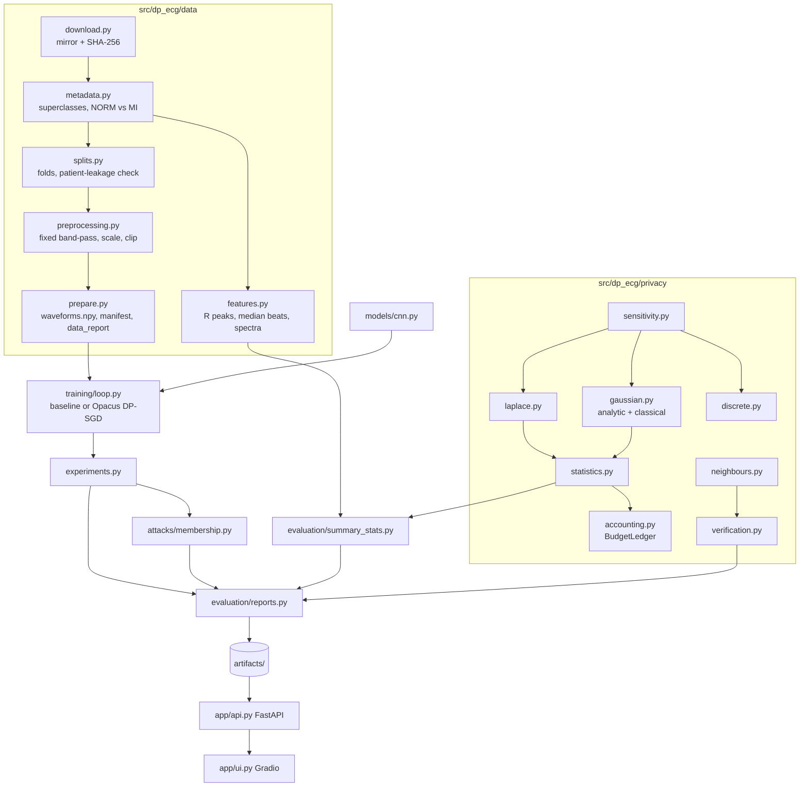

# Architecture

* **Library vs orchestration.** Everything is importable from `dp_ecg`. `cli.py` and `experiments.py` only wire the
  modules together, and the `Makefile` calls the CLI.
* **Configuration.** One YAML file per concern in `configs/`; code reads settings only through `config.load_config`.
* **Artifacts.** Run records (JSON) are written only after metrics are computed. Figures and reports are rebuilt from
  them by `dp-ecg report`, and the API and dashboard read only these files.
* **Separation from training.** The web app never trains or downloads anything.
